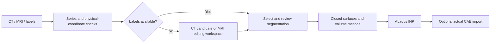

# ct2abaqus-skills

[中文说明](README.zh-CN.md) · [Quick start](docs/quickstart.md) · [Validation](docs/validation.md) · [Releases](https://github.com/nooiceee/ct2abaqus-skills/releases)

[](https://github.com/nooiceee/ct2abaqus-skills/actions/workflows/ci.yml)
[](LICENSE)

An agent skill and executable workflow for converting **CT/MRI image volumes and anatomical segmentations into Abaqus geometry meshes**. It preserves physical coordinates, produces a manual-review workspace, writes real volume elements, and can verify an actual Abaqus/CAE import.

**Research prototype.** The outputs are geometry/mesh candidates. Anatomical segmentation, interfaces and mechanical validity require review; a successful conversion does not establish a load-ready foot model or validated pressure prediction.


*Synthetic regression fixture, not human anatomy or a patient result. The tetrahedral/voxel meshes shown are actual exported data.*

## What it does

| Input | Workflow | Outcome |
|---|---|---|
| Image + supplied segmentation | Select labels, preserve physical positions, split components, reconstruct surfaces and volume mesh | INP; optional CAE; source/mesh audit |
| Calibrated raw CT | Threshold and connected-component **candidate**, review scene, geometry prototype | Candidate labels and mesh, marked `NEEDS_SEGMENTATION_REVIEW` |
| Raw MRI without labels | Prepare a manual/assisted segmentation workspace | `NEEDS_SEGMENTATION`; no invented anatomy or mesh |
| DICOM folder/ZIP with several series | Inventory and explicit selection | No blind series merge |

- Inputs: DICOM directories/ZIPs, NIfTI, NRRD, Slicer segmentations and selected MRB scenes.
- Meshes: Gmsh C3D4 tetrahedra; an explicit native-voxel C3D8 option/fallback.
- Outputs: image/label files, `.mrb` review scene, per-component masks/surfaces, `.inp`, optional `.cae`, quality reports, status and SHA256 manifest.
- Conversion is local. No image-upload service, third-party AI endpoint or finite element solver submission is included.
- SolidWorks is optional; the default route imports orphan meshes into Abaqus.

## Workflow



The review state is retained even if an automatic candidate can already be meshed. Components are not automatically assigned anatomical identities.

## Install as an agent skill

Use an agent that can read local files and launch local software. A chat-only interface cannot control your computer merely by receiving this ZIP.

For Codex, clone the repository into the skills directory, then start a new session. Use a new destination if an older installation already exists.

**PowerShell**

```powershell
git clone https://github.com/nooiceee/ct2abaqus-skills.git "$env:USERPROFILE\.codex\skills\ct2abaqus-skills"
```

**macOS/Linux**

```bash
git clone https://github.com/nooiceee/ct2abaqus-skills.git ~/.codex/skills/ct2abaqus-skills
```

Alternatively, download a release ZIP and extract its `ct2abaqus-skills` folder into your assistant's supported skills location. [SKILL.md](SKILL.md) is the entry point.

Example request:

> Use $ct2abaqus-skills to inspect my uploaded foot CT, prepare segmentation and a review scene, and generate an Abaqus-readable volume mesh and CAE preview. Preserve the source data and flag unresolved anatomical boundaries. Build the model only; do not submit an analysis.

## Run the scripts directly

Required: full **3D Slicer**, external **Python 3.10+**, NumPy and Gmsh. Optional: **Abaqus/CAE** with a normal license. No application binaries or licenses are bundled. Versions executed for the initial release: Windows 11, Slicer 5.12.4, Python 3.13, Abaqus/CAE 2025. Other combinations need a startup/import check.

```bash
python -m venv .venv
```

Install dependencies using `.venv/bin/python` on macOS/Linux or `.venv\Scripts\python.exe` on Windows:

```powershell
# Windows
.venv\Scripts\python.exe -m pip install -r scripts/requirements.txt
```

```bash
# macOS/Linux
.venv/bin/python -m pip install -r scripts/requirements.txt
```

Use that venv's interpreter for subsequent commands. Do not install these packages into Abaqus's Python environment.

Copy [assets/config.example.json](assets/config.example.json), set the image/output/application paths, then run:

```bash
python scripts/run_pipeline.py --config /absolute/path/to/config.json
```

The output directory must be new. The assistant can prepare this configuration from the uploaded files; a nontechnical user does not need to fill every field. See [quick start](docs/quickstart.md) for provided-label, raw-CT and MRI cases.

## Expected outputs

```text
new_output/
  source_image.nrrd
  segmentation.seg.nrrd
  manual_review.mrb
  prepared.json
  masks/ and surfaces/
  model/image_geometry.inp
  model/image_geometry.cae       # only after actual optional import
  mesh_report.json
  abaqus_import.json             # only when executed
  STATUS.json
  manifest.json
```

Outputs depend on the achieved stage. Raw MRI without labels produces a workspace, not an INP. Partial mesh failures are recorded; absent results are not filled with zeros. See the [output contract](references/configuration.md).

## Validation and limits

The initial helper release was exercised on synthetic labeled volumes, raw synthetic CT, synthetic DICOM, an unlabeled-MRI workspace, and an open-data calcaneus case. Exported INP was independently reread for references and signed volumes. Actual CAE imports were checked. See [the validation record](docs/validation.md).

Important limits:

- Thresholds do not establish anatomical identity. Joint fusion, cortex-only masks and small structures require review.
- Label resampling, surface reconstruction and mesh approximation can change occupancy; reports retain these differences.
- Per-part positive volumes do not prove collision-free interfaces between independently meshed parts.
- C3D8 voxel surfaces are stepped and are not a converged contact mesh.
- There are no automatic materials, skin thickness, PA/ligament attachments, contact, loads or analysis steps. These belong to a declared mechanical-model stage.
- This workflow does not establish clinical accuracy, patient-specific calibration, mesh convergence or a solve-time budget.

## Development

Basic tests use synthetic data and do not require Slicer, Gmsh or Abaqus:

```bash
python -m pip install numpy
python -m unittest discover -s tests -v
```

CI runs these tests and Python syntax checks on Linux and Windows. Full Slicer/Abaqus integration evidence is recorded separately; it is not simulated by CI. See [CONTRIBUTING.md](CONTRIBUTING.md), [SECURITY.md](SECURITY.md) and the [changelog](CHANGELOG.md).

## License and citation

Original code and documentation: [MIT](LICENSE). Referenced software and datasets keep their own licenses. **No patient scans, third-party anatomy meshes, Slicer/Abaqus binaries or credentials are distributed.** The figure and test fixtures in this repository are synthetic.

Use [CITATION.cff](CITATION.cff) to cite this software. Cite the original software and datasets separately when used. [Primary sources and provenance](references/sources-and-validation.md).

Maintained by [nooiceee](https://github.com/nooiceee). Bug reports should include a synthetic reproduction and relevant versions, not identifiable patient images.
