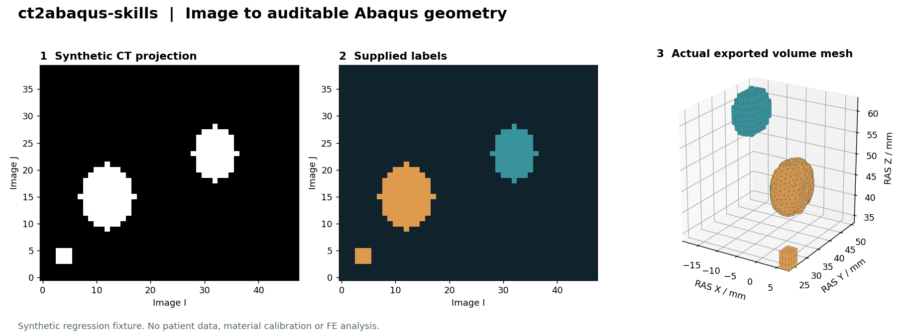

# ct2abaqus-skills

[English](README.md) · [快速开始](docs/quickstart.md) · [核验范围](docs/validation.md) · [下载版本](https://github.com/nooiceee/ct2abaqus-skills/releases)

将 **CT/MRI体数据和组织分割，转换为Abaqus可读取的实体网格与CAE预览** 的技能与脚本工具。保留影像空间坐标、分割来源、质量记录和人工复核工程。

**当前为研究原型。** 输出几何/网格候选；解剖分割、界面与力学有效性仍需核验。导入成功不代表完整整足模型可以直接求解，也不代表已验证足底压力。



*图为合成回归测试，非人体影像；网格为脚本真实导出。*

## 上传后能得到什么

| 你提供的资料 | 助手执行 | 交付层级 |
|---|---|---|
| 影像＋已有标签 | 核对坐标、选择结构、曲面与实体网格重建 | INP、可用时的CAE、质量与来源记录 |
| 可定标的原始CT | 阈值/连通域初分割、查看工程、几何原型 | 标为待解剖复核；连通块不擅自命名成具体骨头 |
| 无标签MRI | 建立人工/辅助分割工作区 | `NEEDS_SEGMENTATION`，不凭空生成组织 |
| 多个DICOM序列 | 先列清序列，明确选取 | 不自动拼接不同扫描或不同对象 |

支持DICOM目录/ZIP、NIfTI、NRRD及部分Slicer工程。使用C3D4四面体，或明确配置的C3D8体素网格。默认是独立部件的孤立网格，SolidWorks不是必需软件。

## 安装与调用

需要能读取本机文件、启动本机程序的助手环境。普通聊天网页不会因为上传技能包就取得本机软件控制能力。

Codex用户可在PowerShell执行：

```powershell
git clone https://github.com/nooiceee/ct2abaqus-skills.git "$env:USERPROFILE\.codex\skills\ct2abaqus-skills"
```

然后启动新会话。已有同名安装时先选择新目录或自行备份，不覆盖正在使用的文件。也可从Releases下载ZIP，将文件夹安装到支持Skills的助手目录。

向助手提供完整影像，并说：

> 使用 $ct2abaqus-skills 处理我上传的CT，检查序列和真实尺寸，准备组织分割与人工查看工程，再生成Abaqus可读取的实体网格和CAE预览。保留原始资料，标出需要人工确认的解剖边界。本次只建模，不自动求解。

助手负责发现软件路径和准备配置，不要求用户逐项填写技术参数。

## 软件与手工分割

- 安装完整3D Slicer应用；外部Python需NumPy/Gmsh。
- 有正常许可的Abaqus/CAE时，脚本实际导入并保存CAE；没有时仍可生成INP。
- 用户可在Slicer里用Paint/Draw/Erase等修正分割，并另存 `.seg.nrrd` 或 `.mrb`。不要只保存截图，保留原影像与物理坐标。
- 初版实际核验环境：Windows11、Slicer5.12.4、Python3.13、Abaqus2025。其他系统/版本需另做启动和导入检查；新版CAE未必能被旧版打开。

直接运行脚本的步骤和配置见[快速开始](docs/quickstart.md)。

## 完整流程

**影像与序列检查 → 分割准备 → 人工解剖复核 → 曲面重建 → 实体网格 → Abaqus导入 → 按研究目标另建物理模型。**

仅原始CT也可先生成原型，但阈值、连通域不等于已准确识别所有骨。MRI不能套用CT灰度阈值。看不清的软骨、PA、韧带不能靠想象补出。

模型输出包含 `manual_review.mrb`、`model/image_geometry.inp`、可用时的 `model/image_geometry.cae`、`STATUS.json` 和哈希清单。缺失或失败的部分如实保留状态。

## 已验证与仍未验证

五条功能路线已执行，并核对真实导出文件；公开CT跟骨案例生成29,253个C3D4并实际导入CAE。详见[核验说明](docs/validation.md)。

正体积不等于部件间无干涉，体素网格不等于接触收敛。软件不自动添加材料、皮肤厚度、关节、PA/韧带、接触、边界和载荷，也不提交有限元分析。完整预测与人体真实性需要后续独立证据。

## 开源与贡献

本仓库原始代码和文档采用[MIT许可](LICENSE)。数据与第三方软件各自遵守原许可；不打包患者影像、第三方解剖模型、软件安装包或凭据。仓库示例图和测试数据为合成内容。

欢迎提交可复现的问题和改进，参见[贡献指南](CONTRIBUTING.md)。请使用合成数据复现，不公开可识别的患者信息。[引用信息](CITATION.cff)。
